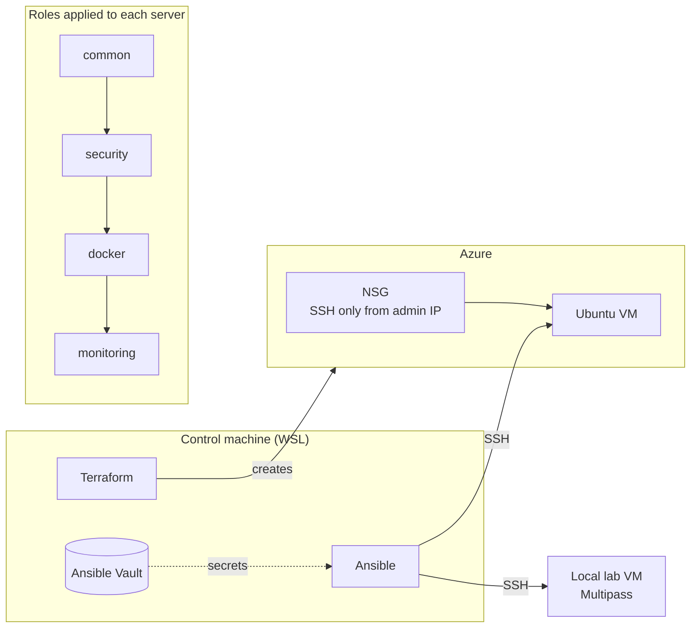

# Ansible Server Setup

[](https://github.com/andre-soler/ansible-server-setup/actions/workflows/ci.yml)

Turns an empty Ubuntu VM into a hardened, monitored server with a single command. Terraform creates the infrastructure on Azure, and Ansible configures everything inside it: base system, security, Docker and a full observability stack ([linux-monitoring-stack](https://github.com/andre-soler/linux-monitoring-stack)).

The same roles run unchanged on a local lab VM and on a real Azure VM. Environments differ only by inventory variables.

## Architecture



| Role | What it does |
| --- | --- |
| **common** | Time sync with chrony, system updates with conditional reboot, `deploy` user, passwordless sudo (validated with `visudo`), SSH key |
| **security** | SSH hardening (key only, no root, `AllowUsers`, validated with `sshd -t`), UFW (deny incoming, SSH rate-limited), Fail2ban reading the journal and banning through UFW, unattended security upgrades |
| **docker** | Docker Engine and Compose from Ubuntu packages, `deploy` added to the `docker` group |
| **monitoring** | Deploys linux-monitoring-stack: `.env` and `msmtp` generated from Vault, systemd timer for the daily report, per-environment Compose override, health checks for all five services |

## Environments

| | Lab | Azure |
| --- | --- | --- |
| Provisioning | Multipass (VirtualBox) | Terraform |
| OS | Ubuntu 26.04 LTS | Ubuntu 24.04 LTS |
| SSH users | `deploy`, `ubuntu` (Multipass access) | `deploy` only |
| UFW trusted networks | Multipass NAT network | none |
| Network edge | home router | NSG allowing SSH only from the admin IP |

Production gets the strictest settings by default: role defaults are secure, and only the lab adds exceptions in `group_vars/lab`.

## Repository structure

```
.
├── site.yml                    # Applies the four roles
├── ansible.cfg
├── collections/requirements.yml
├── inventory/
│   ├── hosts.ini               # lab and azure groups
│   └── group_vars/
│       ├── all/                # shared variables + vault.yml (encrypted)
│       ├── lab/                # lab-only exceptions
│       └── azure/              # production connection settings
├── roles/
│   ├── common/
│   ├── security/
│   ├── docker/
│   └── monitoring/
├── terraform/                  # Azure infrastructure
└── .github/workflows/ci.yml    # ansible-lint + terraform validate
```

## Usage

### Prerequisites

- Ansible and ansible-lint (installed with `pipx`)
- Terraform and Azure CLI (for the Azure environment)
- A Vault password file at `~/.ansible/vault-password` (`chmod 600`)

```bash
ansible-galaxy collection install -r collections/requirements.yml
```

### Azure

```bash
cd terraform
cp terraform.tfvars.example terraform.tfvars   # fill in subscription ID and your IP/32
terraform init
terraform plan -out=tfplan
terraform apply tfplan
cd ..

# put the output IP in inventory/hosts.ini, then:
ansible-playbook site.yml --limit azure
```

When finished:

```bash
cd terraform && terraform destroy
```

### Lab

```bash
ansible-playbook site.yml --limit lab
```

### Dry run and drift detection

```bash
ansible-playbook site.yml --limit azure --check --diff
```

Shows exactly what would change on the server without applying anything. Secret files are excluded from the diff with `diff: false`.

### Accessing Grafana

No dashboard port is exposed. Access goes through an SSH tunnel:

```bash
ssh -N -L 3001:localhost:3000 deploy@<server-ip>
# open http://localhost:3001
```

## Quality

- **Idempotent:** a second run ends with `changed=0`
- **`--check --diff`** runs end to end, including health checks (`check_mode: false` on read-only tasks)
- **ansible-lint** with no violations; variables prefixed with their role name
- **CI** on every pull request: ansible-lint and `terraform fmt -check` / `validate`, with no secrets or cloud credentials in the pipeline
- **Branch protection:** `main` requires a pull request with both CI checks passing

## Technical decisions

- **Ansible connects as `deploy`, not the image's default user.** The same user and key work on any provider, and logs show which actions came from automation.
- **Validation before applying** sudoers (`visudo -cf`) and SSH config (`sshd -t`), so a typo can't lock the server.
- **Firewall order matters:** the SSH rule is created before UFW is enabled.
- **Secrets in Ansible Vault** with the `vault_` indirection convention: `vars.yml` documents every variable, `vault.yml` holds the values.
- **chrony `makestep 1 -1` + `waitsync`** before any apt task. VMs resumed from suspend came back hours behind, and apt rejected package lists as "not valid yet".
- **Docker from Ubuntu packages** instead of Docker's repository: tested with the OS and covered by unattended-upgrades.
- **Per-environment Compose override** instead of changing the monitoring repository: Grafana gets 512 MB here without affecting other installs.
- **2 vCPU minimum.** With 1 vCPU, Grafana took several minutes to start.

## Incidents

Real problems found while building this project, each with root cause and prevention.

| Incident | Root cause | Fix / prevention |
| --- | --- | --- |
| apt rejected package lists as "not valid yet" | VM clock stopped while suspended; chrony only steps the clock right after boot | `makestep 1 -1` and `chronyc waitsync` before apt |
| Task with `become_user` failed on a fresh VM | Switching between two unprivileged users needs ACLs; the `acl` package was missing | `acl` installed in the `common` role. Found only by rebuilding from scratch |
| Grafana never finished starting | 256 MB limit caused thrashing: the binary was evicted and re-read from disk (530 GB of reads in `docker stats`) | Memory raised to 512 MB through a Compose override |
| Override had no effect | The task creating it ran after the stack started | Task order fixed; dependencies come before what uses them |
| Azure rejected resources | Student subscription policy allows only five regions | Allowed regions found with `az policy assignment list` |
| VM size unavailable | Regional capacity for B-series sizes ran out | Region and size changed through `terraform.tfvars` |
| Subnet "not found" after changing region | Subnet referenced the VNet by name, so Terraform didn't notice it was deleted with the VNet | A new `plan` refreshed state; `replace_triggered_by` prevents it |
| "Resource already exists" | A failed allocation left an orphan VM outside Terraform state, plus its disk | Orphans removed with Azure CLI; always check `az disk list` after deleting a VM |
| Replacement left no VM | Changing the SSH key forced a replacement that destroyed the old VM before the new one failed to allocate | Recreated with `apply`; servers are disposable because everything is code |
| CI never ran | Workflow created inside `terraform/.github` because of a relative path | Moved to the repository root |
| Lint regression reached `main` | A PR was merged with a red CI | Branch protection now requires both checks |

## License

[MIT](LICENSE)
